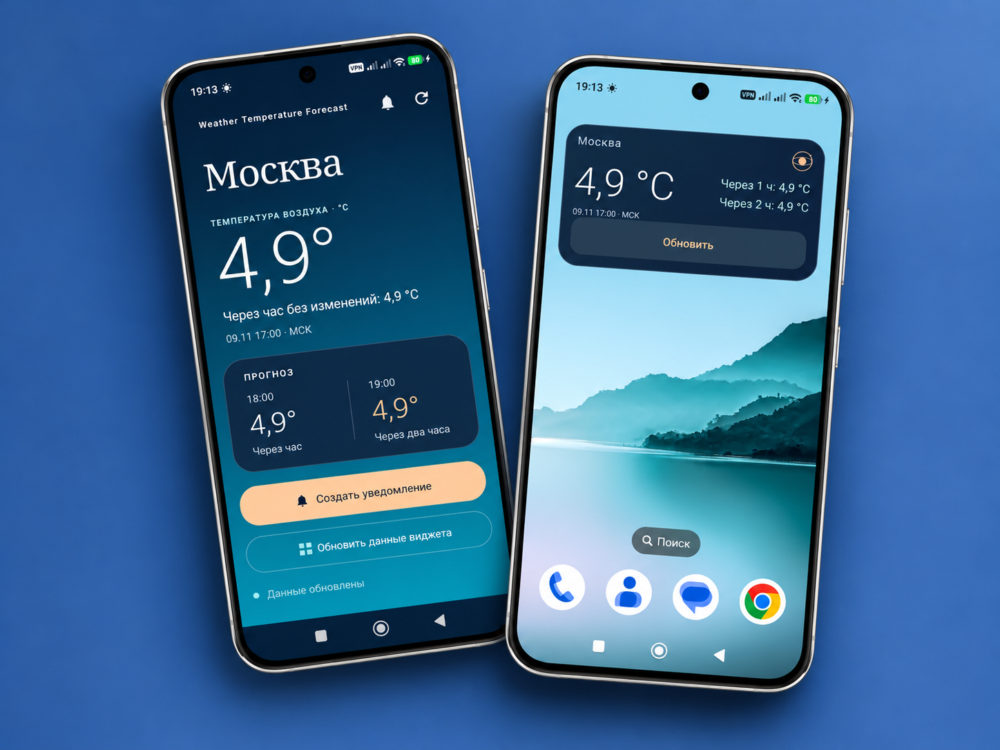

# Weather Forecast App

**Версия:** 1.1 
**Дата выпуска:** 09.11.2026  
**Платформа:** Android  
**Язык программирования:** Kotlin  

---

## О проекте

Weather Forecast App — это лёгкое Android-приложение, разработанное на Kotlin, предназначенное для отображения текущей погоды и краткосрочного прогноза.

Приложение получает погодные данные через Open-Meteo API с использованием Ktor Client и отображает информацию о температуре в простом и удобном интерфейсе.

Также приложение поддерживает автоматическое обновление погоды в фоновом режиме, виджеты рабочего стола, локальное кэширование данных и погодные уведомления.



---

## Возможности

- Отображение текущей погоды и температуры.
- Прогноз температуры на ближайшие два часа.
- Получение погодных данных через Open-Meteo API.
- Автоматическое обновление погоды в фоновом режиме.
- Виджет с текущей погодой на главном экране устройства.
- Ручное обновление погодных данных.
- Уведомления о погоде.
- Локальное кэширование погодных данных.
- Индикаторы загрузки и обработка ошибок.
- Минималистичный интерфейс с плавными анимациями.

---

## Tech Stack

| Component               | Technology                                                       |
| ----------------------- | ---------------------------------------------------------------- |
| Programming Language    | Kotlin                                                           |
| UI                      | Android Views (XML)                                              |
| Networking              | Ktor Client                                                      |
| HTTP Engine             | OkHttp                                                           |
| JSON Serialization      | Kotlinx Serialization                                            |
| Asynchronous Operations | Kotlin Coroutines                                                |
| Widgets                 | Android App Widgets                                              |
| Weather API             | [Open-Meteo API](https://open-meteo.com/?utm_source=chatgpt.com) |
| Build System            | Gradle (Kotlin DSL)                                              |

---

## Установка и запуск

### 1. Клонирование репозитория

```bash
git clone https://github.com/02493/weather-forecast-app.git
```

### 2. Открытие проекта

1. Запустите **Android Studio**.
2. Выберите **Open** и укажите папку с клонированным проектом.
3. Дождитесь завершения синхронизации Gradle.

### 3. Сборка и запуск

1. Подключите Android-устройство или запустите эмулятор.
2. Выберите конфигурацию `app`.
3. Нажмите **Run** для сборки и установки приложения.

**Примечание:** Для работы приложения не требуется API-ключ или дополнительная настройка. Используется Open-Meteo API, предоставляющий погодные данные без необходимости регистрации ключа.

---

## Известные проблемы

- По умолчанию приложение использует координаты Москвы.
- Работа фонового обновления зависит от подключения к интернету и ограничений Android.
- Для получения уведомлений на Android 13 и новее необходимо разрешить отправку уведомлений.
- При медленном интернет-соединении загрузка погодных данных может занимать больше времени.

---

## Планы по развитию

- Добавить возможность поиска и выбора различных городов.
- Улучшить интерфейс и визуальное оформление приложения.
- Расширить информацию о прогнозе погоды.
- Улучшить внешний вид и функциональность виджета.
- Добавить дополнительные настройки персонализации.
- Оптимизировать фоновое обновление данных и систему уведомлений.

---

## Лицензия

Проект предназначен для учебного и личного использования.
